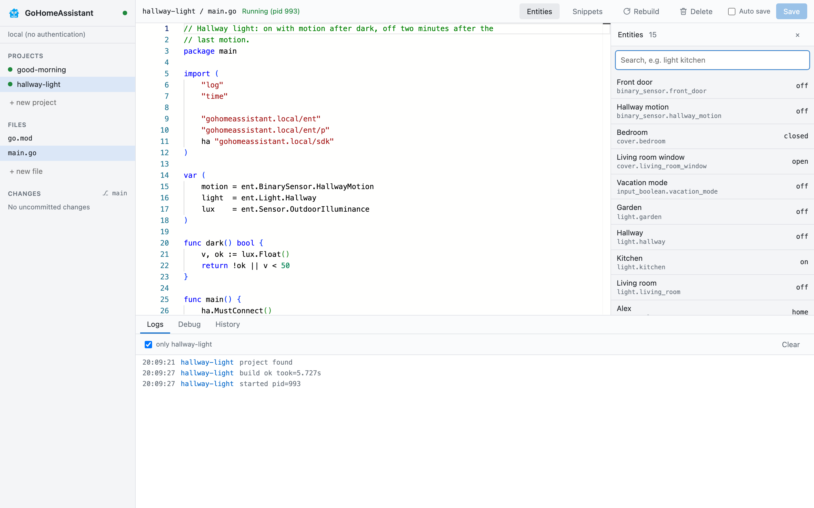
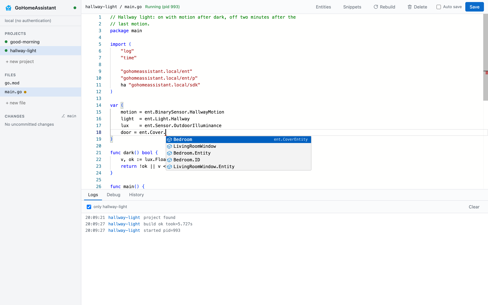
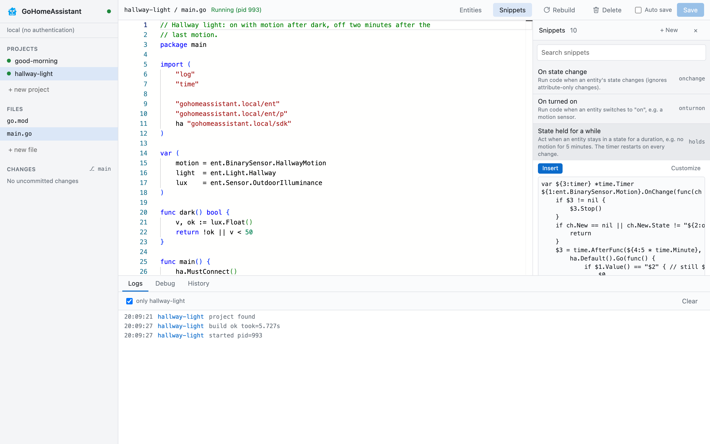

# GoHomeAssistant

Write Home Assistant automations in **Go**, in a web IDE that runs next to
Home Assistant. Every project is a small Go program. Save a file and it is
rebuilt and swapped within about a second. Home Assistant and GoHomeAssistant
keep running, and a project only restarts if its compiled code actually
changed.

- **Typed entities and services**, generated from your instance:
  `ent.Light.Kitchen.TurnOn(p.LightTurnOn{BrightnessPct: 50})`
- **Web IDE**: Monaco editor with gopls (completion for your entities,
  services and their parameters, hover docs, auto-imports, live errors,
  gofmt on save)
- **Hot reload** without restarting anything. If the new code doesn't
  compile, the previous version keeps running.
- **Debugger in the browser**: breakpoints, stepping, call stack, variables
  (Delve)
- **Git per project**: changes, diffs, commits, history, restore old versions
- **Entity browser** with live state, attributes and "insert as code"
- **Logs that wait for you**: kept on disk, so you can open the UI days later
  and see what happened; filter by project and level, search, and a marker
  shows what is new since your last visit
- **Execution traces**: every handler run with what triggered it, what it
  logged, which services it called and what failed
- **Login with your Home Assistant account** (administrators only)



| Completion for your entities | Snippets |
|---|---|
|  |  |

## Install as a Home Assistant app

For HA OS or HA Supervised. The UI then lives in the HA sidebar, behind HA's
own login (administrators only). Since HA 2026.2, add-ons are called *apps*.

[](https://my.home-assistant.io/redirect/supervisor_add_addon_repository/?repository_url=https%3A%2F%2Fgithub.com%2Fgusimo%2Fgohomeassistant)

1. HA → *Settings* → *Apps* → *Install app* → menu (⋮, top right) →
   *Repositories*, add `https://github.com/gusimo/gohomeassistant`
   (or use the button above).
2. Open **GoHomeAssistant** in the app store, *Install*, *Start*, and enable
   *Show in sidebar*.

HA downloads a prebuilt image (amd64 or aarch64), so installing takes about a
minute. New versions show up as updates in HA.

Projects live in `addon_configs/<id>_gohomeassistant/projects` (reachable via
Samba/SSH/Studio Code Server, included in backups). The app talks to HA
through the Supervisor and is only reachable through Ingress.

If it doesn't show up, the Supervisor rejected it: *Settings* → *System* →
*Logs* → menu → *Supervisor*, look for "gohomeassistant".

### Local install (development)

To try changes before publishing them, build a local app; HA then builds the
image itself from the sources (a few minutes):

```sh
./start.sh addon     # builds dist/addon/gohomeassistant (and a .tar.gz)
```

1. Copy the folder `dist/addon/gohomeassistant` into the `local_apps` folder
   of your HA: via the Samba app (share `local_apps`), or with the Terminal &
   SSH app: `scp -r dist/addon/gohomeassistant root@<your-ha>:/local_apps/`.
2. HA → *Settings* → *Apps* → *Install app* → menu (⋮) → *Check for updates*;
   reload the page if needed.
3. Under *Local apps*, open **GoHomeAssistant**, *Install*, *Start*.

To update, bump `version` in `addon/config.yaml`, rebuild, copy again, *Check
for updates* and *Update*. Don't run the local and the repository app at the
same time: each runs its own projects, so your automations would run twice.

### Publishing a version

Bump `version` in `addon/config.yaml` (and add a `CHANGELOG.md` entry) and
push to `main`. The *Image* workflow builds
`ghcr.io/gusimo/{amd64,aarch64}-gohomeassistant:<version>`; HA offers the
update once the version is in the repository.

## Quick start (standalone Docker)

You need Docker and a Home Assistant long-lived access token (HA → your
profile → *Security* → *Long-lived access tokens*).

```sh
cp .env.example .env     # then set HA_URL and HA_TOKEN in .env
./start.sh               # builds the image and starts the container
```

Open <http://127.0.0.1:8099> and log in with your HA account. Create a
project with **+ new project**.

| Command | |
|---|---|
| `./start.sh` | build the image and (re)start the container |
| `./start.sh logs` | follow the logs |
| `./start.sh stop` | stop the container (projects and data are kept in the `gha-data` volume) |
| `./start.sh dev` | run without Docker (needs Go 1.24 and Node; no debugger on macOS) |
| `./start.sh addon` | build the Home Assistant add-on folder (see above) |

## Writing automations

A project is a directory with a `go.mod` and Go files. New projects start
from a template:

```go
package main

import (
	"log"
	"time"

	"gohomeassistant.local/ent"
	"gohomeassistant.local/ent/p"
	ha "gohomeassistant.local/sdk"
)

func main() {
	ha.MustConnect()

	// React to state changes of one entity.
	ent.BinarySensor.FrontDoor.OnChange(func(ch ha.StateChange) {
		if ent.BinarySensor.FrontDoor.IsOn() {
			ent.Light.Hall.TurnOn(p.LightTurnOn{BrightnessPct: 80, Transition: 2})
		}
	})

	// Read states.
	if w, ok := ent.Sensor.Power.Float(); ok && w > 3000 {
		ent.Svc.Notify.MobileAppPhone(p.NotifyMobileAppPhone{Message: "High power usage"})
	}

	// Timers: run code on the handler goroutine later.
	time.AfterFunc(10*time.Minute, func() {
		ha.Default().Go(func() { log.Println("ten minutes later") })
	})

	ha.Default().Run() // blocks until the project is stopped or reloaded
}
```

**Both imports are local.** `gohomeassistant.local/sdk` (the `ha` package,
source in `sdk/`) is bundled with GoHomeAssistant, and
`gohomeassistant.local/ent` is generated from your instance. Neither is
downloaded: GoHomeAssistant resolves them through a `go.work` it writes for
each project, and `.local` signals that they can't be fetched from anywhere.
The SDK therefore always matches the running GoHomeAssistant; it is updated
together with the image or add-on.

**Generated entities (`ent`).**
- Every entity is a field of its domain: `ent.Light`, `ent.Sensor`,
  `ent.BinarySensor`, and so on.
- Every service that targets a domain is a method on its entities.
- Parameters are optional structs in the separate package
  `gohomeassistant.local/ent/p` (so `ent.` lists only your domains), typed
  from HA's service descriptions: `p.LightTurnOn{BrightnessPct: 80}`. Zero
  values are not sent; use `Extra: map[string]any{...}` for anything else.
- `ent.Svc.<Domain>.<Service>(...)` covers all services, including those
  without a target (scripts, notify) and calls by area or device
  (`ha.Target{AreaID: ...}`).
- It is regenerated on startup, whenever entities or services are added or
  removed (entity registry, service registry, entities appearing or
  disappearing; batched with a 3-second delay), and every 10 minutes. Then
  all projects are rebuilt, but a project only restarts if its binary
  changed.
- If an entity a project uses is **removed or renamed**, that project's build
  fails (shown in the UI) and the previous version keeps running. After a
  restart of GoHomeAssistant there is no previous version, so the project
  doesn't run until you fix it. An entity that is merely **unavailable** stays
  in `ent`; its state is `"unavailable"`. There are no HA notifications for
  either case yet.

**SDK (`ha`).**
- `ha.MustConnect()` / `ha.Connect()`
- `c.State(id)`, `c.States()`: from a local cache, always current
- `c.OnStateChange(id, fn)`: `""` for all entities
- `c.OnEvent(type, fn)`: any HA event
- `c.CallService(...)`, `c.FireEvent(...)`
- `c.Call(msg)`: any WebSocket command
- `c.Go(fn)`
- `c.Run()`

Handlers run one at a time, so you don't need locks. A panic in a handler is
logged as an error and doesn't stop the project.

If Home Assistant restarts or the connection drops, projects keep running.
Once it is back they reload all states, and handlers are called for what
changed in the meantime.

Use the standard `log` package for output. Lines appear in the Logs tab
(GoHomeAssistant adds the time) and in the trace of the handler that wrote
them.

You can import third-party Go modules as usual. Just add the import: the
module is added to `go.mod` / `go.sum` and downloaded on the next build (this
needs internet access).

## The web UI

- **Editor**: ⌘S / Ctrl+S formats (gofmt), saves and hot-reloads.
  **Auto save** (switch in the header, on by default) saves 1.5 s after you
  stop typing, without formatting. Every save hot-reloads the project, so
  turn it off for delicate edits or while debugging. *Rebuild* saves
  unsaved changes first. Build errors appear as red markers. Files changed on disk (git, other editors) reload
  automatically unless you have unsaved edits.
  **Go to definition** (F12, ⌘/Ctrl+click, or the context menu; long-press
  on a phone) opens the definition: files of the project in the editor,
  the SDK, the generated entities, Go's standard library and third-party
  modules read-only.
- **Entities** (button in the header): search, live state, attributes.
  **Insert** puts e.g. `ent.Sensor.Power` at the cursor.
- **Snippets** (button in the header): ready-made code such as *On state
  change*, *On custom event*, *State held for a while*, *Turn on with
  parameters*, timers. **Insert** puts one at the cursor; Tab jumps between
  its fields and missing imports are added. In the editor, typing a snippet's
  prefix (e.g. `onevent`) offers it in the completion list.
  Your own snippets: **+ New** (prefilled with the code selected in the
  editor) or **Customize** on a built-in one. They are stored in
  `/data/gohomeassistant/snippets.json` and shared by all users. Placeholders:
  `$1`, `${1:default}`, `$0` for the final cursor; a literal `$` is `\$`.
- **Debug** tab: turn on *Debug mode* for a project. It is rebuilt without
  optimizations and runs under Delve, but keeps running normally until a
  breakpoint is hit. Click left of a line number to set a breakpoint. You
  get Continue (F5), Pause, Step over (F10), Step into (F11), Step out
  (Shift+F11), the call stack and expandable variables. After a hot reload
  the debugger re-attaches with your breakpoints. If the connection to the
  debugger is lost (phone asleep, network change) it reconnects, and a
  program paused at a breakpoint stays paused there.
- **Changes** (sidebar) and **History** tab: every project is a git
  repository (new projects get an initial commit; older ones get an
  *Initialize git* button). Click a changed file to see its diff, commit with
  a message (author: your HA user) or discard. In History, open any commit's
  files as a diff and **Restore this version** into the working copy.
- **Logs** tab: output of all projects and GoHomeAssistant itself. Filter by
  project and level (*warnings and errors* shows build failures, crashes,
  handler panics and failed service calls), or search. Logs are kept on disk
  (up to 64 MB, oldest deleted first) and survive restarts; **Load older**
  goes back in time. A line marks what is new since your last visit, and the
  tab shows a count of warnings and errors you haven't seen.
- **Traces** tab: one line per handler run, newest first, e.g.
  `binary_sensor.front_door: off → on · 1 call · 2 ms`. Open it to see the
  steps: log lines, service calls with their data, duration and error, and a
  panic with its stack. Click a source position (`main.go:18`) to jump to
  that line. Runs in which a call failed or the handler panicked are red and
  counted on the tab. Handlers for one entity or one event type are always
  traced; "all entities" / "all events" handlers and `Go` only when they log
  or call something. Service calls outside of a handler (in `main`, in your
  own goroutines) get a trace of their own. Traces with steps are kept on
  disk like logs; empty ones only until the next restart.

## Configuration

Everything goes in `.env` (see `.env.example`). `.env` is ignored by git and
by Docker builds, because it contains your token.

| Variable | Default | |
|---|---|---|
| `HA_URL` | | Home Assistant URL as seen from GoHomeAssistant |
| `HA_TOKEN` | | Long-lived access token |
| `GHA_AUTH` | `ha` | `ha`: log in with your HA account, admins only. `none`: no login (development only) |
| `GHA_BIND` | `127.0.0.1` | Interface for the UI. Use `0.0.0.0` to reach it from your network |
| `GHA_PORT` | `8099` | Port for the UI |
| `GHA_HA_PUBLIC_URL` | `HA_URL` | HA's URL as your browser sees it, if different (e.g. `HA_URL=http://homeassistant:8123` inside a Docker network) |
| `GHA_PUBLIC_URL` | from request | GoHomeAssistant's own URL, if it can't be derived (reverse proxy) |
| `GHA_PROJECTS_HOST_DIR` | Docker volume | Keep projects in a folder on this machine instead, e.g. `./projects` |
| `GHA_WATCH_POLL` | off | e.g. `1s`: also poll for file changes. Needed for changes made outside the UI to a bind-mounted folder on macOS/Windows |
| `GHA_GIT_EMAIL` | `gohomeassistant@localhost` | E-mail address for commits |

Inside the container the defaults are `GHA_PROJECTS_DIR=/data/projects`,
`GHA_DATA_DIR=/data/gohomeassistant` and `GHA_HTTP_ADDR=:8099`.

### Without the script

```sh
docker build -t gohomeassistant .
docker run -d --name gohomeassistant -p 127.0.0.1:8099:8099 \
  --env-file .env -v gha-data:/data gohomeassistant
```

## Security

The UI can run arbitrary code with full access to Home Assistant. Therefore:

- Only **HA administrators** can log in. GoHomeAssistant uses HA's own
  OAuth login, checks `is_admin`, revokes the HA token it received and keeps
  its own session (an `HttpOnly`, `SameSite=Lax` cookie, valid 30 days).
  Sessions survive restarts: `/data/gohomeassistant/sessions.json` (mode
  0600) stores only SHA-256 hashes of the session tokens.
  Requests that change something must come from the UI's own origin.
- As an add-on, only requests coming through HA Ingress (from the
  Supervisor) are accepted; HA does the login.
- `GHA_AUTH=none` disables all of this. Use it only on a machine nobody else
  can reach.
- The file and git APIs reject paths outside a project and hidden files
  (`.git`).

## How it works

```
 Browser ── HTTP / SSE / WebSocket ──► GoHomeAssistant ── one WebSocket ──► Home Assistant
 (React, Monaco)                        │  auth, REST API, logs
                                        │  gopls (LSP) and Delve (DAP) bridges
                                        │  entity code generator
                                        │  watches projects, builds, supervises
                                        │  unix socket (HA protocol subset)
                                        ├── project A  (go build, runs as a process)
                                        └── project B  (optionally under Delve)
```

| Package | |
|---|---|
| `internal/ha` | Reconnecting HA client; subscriptions survive reconnects |
| `internal/bridge` | Shares the HA connection with projects; cleans up their subscriptions |
| `internal/project` | Discovery, file watching, builds (`go.work` with SDK and `ent`), process swap, restart with backoff, debug mode |
| `internal/codegen` | Generates `ent` from `get_states` / `get_services` |
| `internal/server` | REST API, event stream, LSP/DAP bridges, git |
| `internal/auth` | HA OAuth login, Ingress mode, sessions |
| `internal/logbus` | Logs, traces and status: fan-out to the UI, history on disk |
| `sdk/` | The module projects import (no dependencies) |
| `web/` | The UI (React, Vite, Monaco), embedded into the binary |
| `addon/` | Home Assistant app definition (`config.yaml`, docs) |
| `repository.yaml`, `.github/workflows/` | app repository and image build |

## Development

```sh
go test -race ./...                     # unit and end-to-end tests (fake HA server)
cd web && npm install && npm run dev    # UI on :5173, proxies /api to :8099
```

The debugger test needs Delve on Linux. Run it in a container:

```sh
docker run --rm -v "$PWD":/src -w /src golang:1.24 sh -c \
  'go install github.com/go-delve/delve/cmd/dlv@v1.25.2 && go test -run TestDebugger ./internal/project/'
```

`npm run build` writes into `internal/server/dist/app`, which `go build`
embeds.

## Known limitations

- Debug mode is not kept across restarts.
- While a program is paused in the debugger, HA events queue up (about 25
  minutes on a busy instance). Beyond that the project reconnects.
- Each open project runs its own gopls (a few hundred MB of memory).
- What a project prints is logged as INFO; only failures GoHomeAssistant sees
  itself (build errors, crashes, handler panics, failed service calls) are
  warnings or errors.
- Git is local only for now.

## Roadmap

1. ✅ Host, SDK, hot reload
2. ✅ Typed entities and services
3. ✅ Web UI: editor, completion, logs, entity browser, HA login
4. ✅ Debugging in the UI
5. Git: ✅ local; next: remotes (push/pull with an SSH key or token)
6. ✅ Home Assistant app: repository with prebuilt images, local install

## License

GoHomeAssistant is free software under the
[GNU Affero General Public License v3.0](LICENSE). You may use, change and
share it. If you distribute it, or run a changed version as a service for
others, you must publish the full source under the same license.

Additional term (AGPL section 7(b)): forks and works based on it must keep the
[NOTICE](NOTICE) file and credit the original author, for example
"Based on GoHomeAssistant by Guido Simon (https://github.com/gusimo/gohomeassistant)".

Third-party components: [THIRD_PARTY_NOTICES.md](THIRD_PARTY_NOTICES.md).
